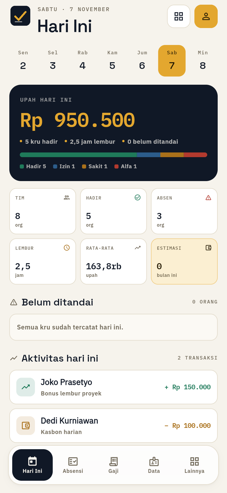
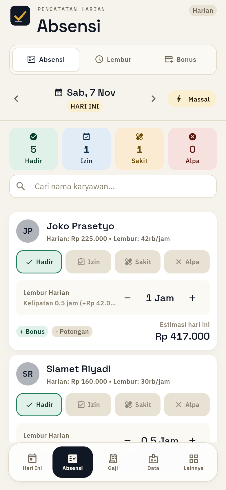
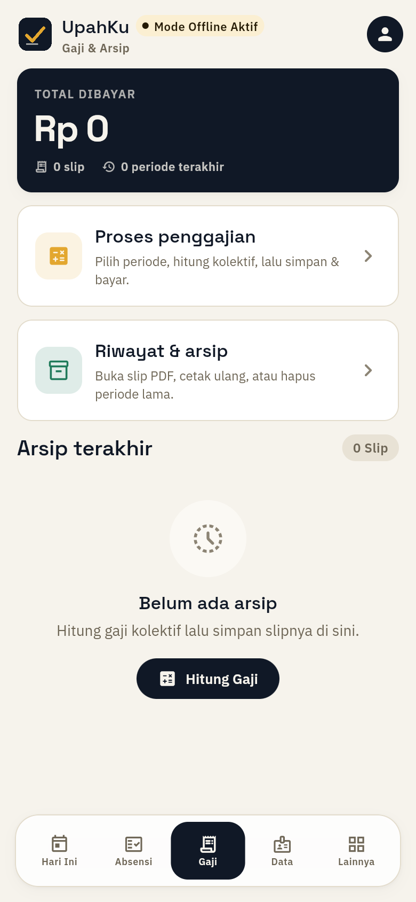
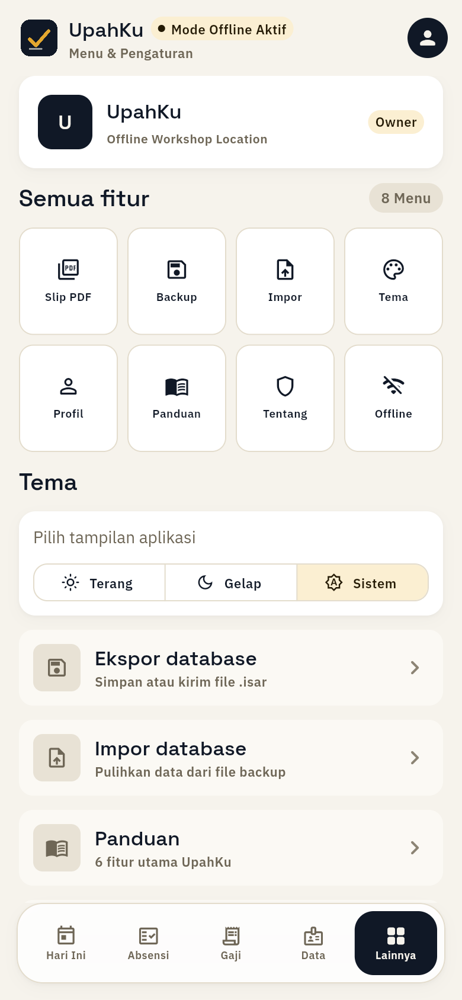
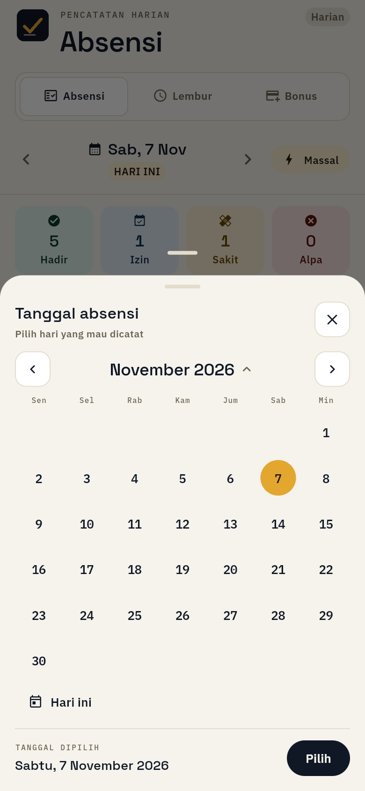
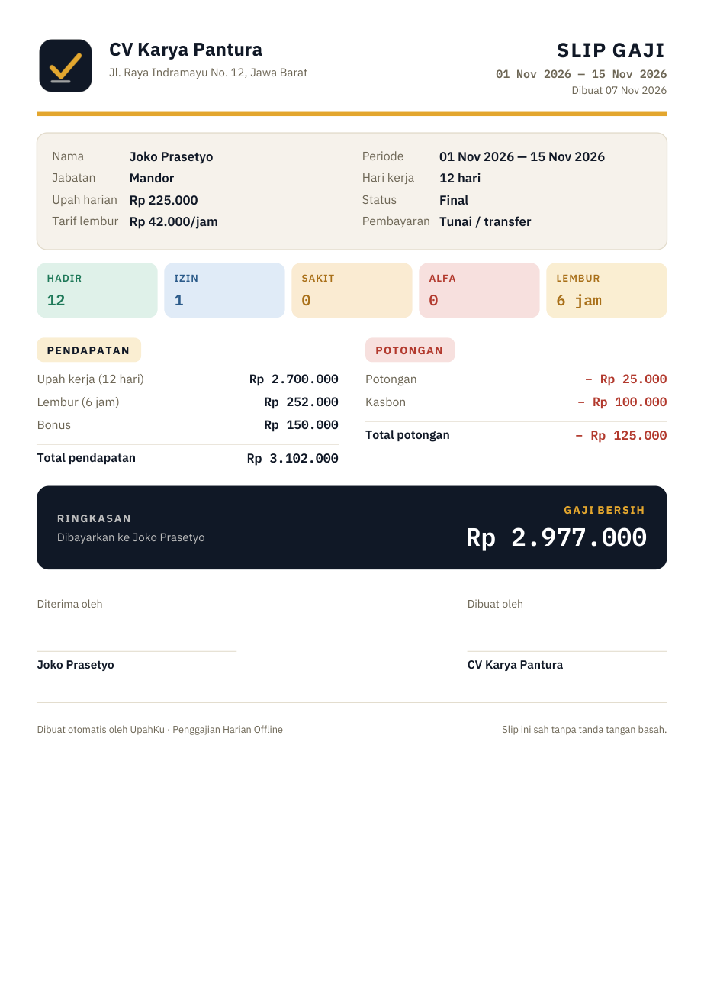

<p align="center">
  
</p>

<h1 align="center">UpahKu</h1>

<p align="center">
  <strong>Payroll harian offline untuk UMKM: absensi, lembur, kasbon, slip PDF.</strong><br/>
  <sub>Flutter · Riverpod · Isar · 100% data di perangkat</sub>
</p>

<p align="center">
  
  
  
  
  
</p>

---

## Tentang

UpahKu menggantikan buku absensi dan spreadsheet gaji untuk bisnis dengan pekerja harian —
kontraktor, katering, bengkel, kebun, restoran, dan toko.

Satu alur, tanpa internet:

**tandai kru → kunci hari → hitung → bayar → slip PDF**

Tidak ada akun, tidak ada server, tidak ada data yang keluar dari perangkat.

---

## Tampilan

| Hari Ini | Absensi | Gaji |
|---|---|---|
|  |  |  |

| Lainnya | Pilih tanggal | Slip PDF |
|---|---|---|
|  |  |  |

---

## Fitur

### 1. Hari Ini
- Angka utama: **upah hari ini** (hadir × upah harian + lembur).
- Enam statistik: tim, hadir, absen, lembur, rata-rata upah, estimasi bulan ini.
- Daftar kru yang **belum ditandai** — langsung tap untuk set status.
- Aktivitas hari ini: bonus, potongan, kasbon.
- Aksi cepat ke Absensi, Lembur, Bonus, dan Gaji.

### 2. Absensi
- Tiga panel dalam satu tab: **Absensi · Lembur · Bonus**.
- Status per kru: Hadir, Izin, Sakit, Alfa.
- **Tandai massal** untuk seluruh kru.
- Lembur per orang dengan kelipatan 0,5 jam dan biaya otomatis.
- Bonus, potongan, dan kasbon sebagai transaksi hari itu.
- Auto-save ke database lokal setiap perubahan.

### 3. Gaji
- Proses kolektif per periode (tanggal mulai–selesai).
- Rincian per kru: hari kerja, lembur, bonus, kasbon, potongan, gaji bersih.
- Simpan & bayar → arsip periode.
- Riwayat slip, buka ulang, cetak, atau hapus.

### 4. Slip gaji PDF
- Ukuran **A5**, siap cetak atau dibagikan lewat menu share (WhatsApp, email, drive).
- Header logo + nama usaha + alamat.
- Identitas kru, upah harian, tarif lembur, periode, status.
- Ringkasan kehadiran: Hadir / Izin / Sakit / Alfa / Lembur.
- Pendapatan, potongan, kasbon, dan **gaji bersih**.
- Area tanda tangan “Diterima oleh” dan “Dibuat oleh”.

### 5. Data karyawan
- Tambah, edit, nonaktifkan, hapus.
- Upah harian dan tarif lembur per orang.
- Pencarian nama/jabatan, filter aktif/nonaktif/punya kasbon.

### 6. Lainnya
- Menu lengkap: Slip PDF, Backup, Impor, Tema, Profil, Panduan, Tentang, Mode Offline.
- Tema **Terang / Gelap / Sistem**.
- Backup & restore database `.isar`.
- Profil usaha (nama + alamat) untuk header slip.

### 7. Date picker Indonesia
- Bottom sheet kalender sendiri, bukan dialog bawaan.
- Nama hari dan bulan Bahasa Indonesia: **Senin–Minggu**, **Januari–Desember**.
- Mode pilih bulan + navigasi tahun.
- Tombol “Hari ini”, ringkasan tanggal, dan aksi “Pilih”.
- Tanggal di luar rentang otomatis disabled.

### 8. Offline-first
- Tidak butuh internet untuk absensi, hitung gaji, atau cetak slip.
- Semua data di Isar (lokal).
- Backup manual ke file `.isar` untuk pindah perangkat.

---

## Desain — “Ledger Lapangan”

| Token | Nilai | Dipakai untuk |
|---|---|---|
| Ink | `#101826` | teks utama, panel hero, tombol |
| Paper | `#F6F3EC` | background |
| Amber | `#E3A72F` | angka uang, status aktif |
| Success | `#1F7A5A` | hadir, pemasukan |
| Danger | `#B23A2E` | alfa, potongan |
| Line | `#E3DCCC` | border 1px kartu |

**Tipografi (bundled offline):**

| Family | Peran |
|---|---|
| **Space Grotesk** | judul, angka hero |
| **IBM Plex Sans** | body, label, tombol |
| **IBM Plex Mono** | semua nominal, tanggal, label teknis (tabular) |

**Logo:** `logo_mark.png` (ink + amber check + garis ledger), varian dark `logo_mark_dark.png`,
dan `logo_foreground.png` untuk adaptive icon.

**Ikon:** satu family garis (Material Outlined), tanpa emoji, tanpa campuran style.

**Komponen:** tombol pill (bukan full-bleed), kartu border 1px, bottom sheet radius 24,
floating dock 5 tab dengan active pill.

---

## Alur kerja

```text
┌──────────────────────────────┐
│  Data karyawan               │
│  nama · jabatan · upah/hari  │
└──────────────┬───────────────┘
               │
               ▼
┌──────────────────────────────┐
│  Absensi harian              │
│  H / I / S / A · lembur      │
│  bonus · potongan · kasbon   │
└──────────────┬───────────────┘
               │
               ▼
┌──────────────────────────────┐
│  Gaji › Proses               │
│  pilih periode → hitung      │
│  kolektif → simpan & bayar   │
└──────────────┬───────────────┘
               │
               ▼
┌──────────────────────────────┐
│  Slip PDF A5                 │
│  cetak / share               │
└──────────────────────────────┘
```

---

## Arsitektur

| Layer | Isi |
|---|---|
| `core/` | token warna, tipografi, tema, formatter, PDF generator |
| `data/` | model Isar, repository implementasi, mock untuk web |
| `domain/` | kontrak repository |
| `presentation/` | halaman, provider Riverpod, widget design system |

```text
lib/
├── core/
│   ├── constants/colors.dart        # token ink/paper/amber
│   ├── theme/app_theme.dart         # tombol pill, card, input
│   ├── theme/typography.dart        # Space Grotesk / Plex Sans / Plex Mono
│   └── utils/pdf_generator.dart     # slip A5
├── data/
│   ├── models/                      # Karyawan, Absensi, Lembur, Transaksi, Penggajian
│   └── repositories/                # Isar + mock web
├── presentation/
│   ├── pages/
│   │   ├── dashboard/               # Hari Ini
│   │   ├── absensi/                 # Absensi + Lembur + Bonus
│   │   ├── gaji/                    # hub Proses & Riwayat
│   │   ├── karyawan/                # Data
│   │   └── lainnya/                 # menu & pengaturan
│   ├── providers/                   # Riverpod
│   └── widgets/ds/                  # design system, bottom nav, date picker
└── main.dart
```

**Stack:** Flutter 3.35 · Dart 3.9 · Riverpod 2 · Isar 3 · `pdf` + `printing` ·
`share_plus` · `file_picker` · `shared_preferences`.

---

## Rumus gaji

```text
upah kerja     = jumlah hadir × upah harian
upah lembur    = total jam lembur × tarif lembur
pendapatan     = upah kerja + upah lembur + bonus
potongan       = potongan lain + kasbon
gaji bersih    = pendapatan − potongan
```

Semua nominal disimpan sebagai `double` rupiah utuh dan ditampilkan dengan
pemisah ribuan Indonesia (`Rp 1.500.000`). Angka memakai tabular figures agar
tidak bergeser saat data berubah.

---

## Mulai

**Prasyarat:** Flutter 3.35+ dan Dart 3.9+.

```bash
flutter pub get
flutter run
```

Build Android:

```bash
# universal (~62 MB, semua ABI)
flutter build apk --release

# hemat ukuran: satu ABI saja (~24 MB, HP modern)
flutter build apk --release --target-platform android-arm64
```

`--target-platform` juga memangkas `.so` plugin (Isar) milik ABI lain, jadi APK
benar-benar hanya memuat satu arsitektur tapi `versionCode` tetap sama.

### Preview web

Web memakai database in-memory (bukan Isar) untuk preview desain:

```bash
flutter build web --release --no-wasm-dry-run
python -m http.server 4180 --directory build/web
```

Buka:

```text
http://127.0.0.1:4180/?preview=1
```

- `?preview=1` — langsung masuk shell + data demo (hanya web).
- `?tab=0..4` — buka tab tertentu: `0` Hari Ini, `1` Absensi, `2` Gaji, `3` Data, `4` Lainnya.

Di Android/iOS, aplikasi memakai Isar dan tidak menjalankan seed demo.

---

## Testing

```bash
flutter analyze
flutter test
```

- `test/widget_test.dart` — perhitungan gaji bersih.
- `test/pdf_generator_test.dart` — generate slip PDF lengkap (menulis `build/slip-test.pdf`).

---

## Data & privasi

- Semua data karyawan, absensi, lembur, transaksi, dan slip tersimpan **lokal**.
- Tidak ada server, akun, analytics, atau sinkronisasi cloud.
- Backup/restore manual lewat file `.isar` di menu **Lainnya**.
- Web preview hanya untuk demo; data hilang saat halaman ditutup.

---

## Pembaruan terbaru

- **v1.1.1** — perbaikan database: instance Isar "zombie" (terdaftar tapi koleksi gagal
  di-attach) tidak lagi dipakai ulang, sehingga error `LateInitializationError` hilang dan
  tombol "Coba lagi" benar-benar memulihkan. Service database kini singleton.
- Design system **Ledger Lapangan**: ink/paper/amber, kartu border 1px, tombol pill.
- Font baru dibundel offline: **Space Grotesk, IBM Plex Sans, IBM Plex Mono**.
- Logo baru: mark ink + amber check, varian light/dark, adaptive icon, favicon.
- Navigasi 5 tab: **Hari Ini · Absensi · Gaji · Data · Lainnya** + floating dock.
- Layar **Hari Ini** baru: hero upah, 6 statistik, kru belum ditandai, aktivitas, aksi cepat.
- **Gaji** jadi hub: Proses + Riwayat + arsip terakhir.
- **Lainnya**: 8 menu, tema, backup/impor, panduan, tentang.
- **Date picker** kustom dengan nama hari/bulan Indonesia + mode bulan/tahun.
- **Slip PDF** ditulis ulang: logo baru, Plex Sans/Mono, kehadiran, pendapatan/potongan,
  gaji bersih, tanda tangan, footer.
- Perbaikan: header Absensi, warna ikon menu diseragamkan, format `42rb/jam`,
  tanggal tidak terpotong.

---

## Lisensi

MIT — lihat [LICENSE](LICENSE).

---

## Unduh

<p align="center">
  <a href="https://github.com/rhsa-fr/UpahKU/releases/download/v1.1.1/upahku-v1.1.1-arm64-v8a.apk">
    <strong>Unduh UpahKu v1.1.1 — APK 24,4 MB (arm64)</strong>
  </a><br/>
  <sub>atau <a href="https://github.com/rhsa-fr/UpahKU/releases/download/v1.1.1/upahku-v1.1.1-universal.apk">versi universal 62,6 MB</a> untuk HP lama/emulator</sub>
</p>

| File | Ukuran | Untuk |
|---|---|---|
| `upahku-v1.1.1-arm64-v8a.apk` | 24,4 MB | **Disarankan** — HP Android modern |
| `upahku-v1.1.1-universal.apk` | 62,6 MB | HP 32-bit lama, emulator |

- Minimal **Android 7.0 (API 24)**. Kedua APK versionCode 3 dan bertanda tangan sama — pasang salah satu.
- APK ditandatangani **release key** (`CN=UpahKu`), bukan debug key.
- Versi lain: [semua rilis](https://github.com/rhsa-fr/UpahKU/releases).
- `SHA256 arm64 FEBE4A433AB853BFC1CB3A6D3DBBDD229F0D5DFB80909A9F05345F03BC4719C9`
- `SHA256 universal 6238859CE4402861831DA6D7D2E121B8022ADCE2102DFB6A793C4BFFCC2BCEDF`

> [!IMPORTANT]
> Sudah pernah memasang **v1.0.0**? Versi itu memakai debug key, jadi Android menolak update
> (`INSTALL_FAILED_UPDATE_INCOMPATIBLE`). Backup dulu lewat **Lainnya → Backup**, uninstall v1.0.0,
> pasang v1.1.1, lalu restore backup. Dari **v1.1.0** bisa update langsung tanpa uninstall.

<p align="center">
  <strong>UpahKu — payroll harian, tanpa internet.</strong>
</p>
