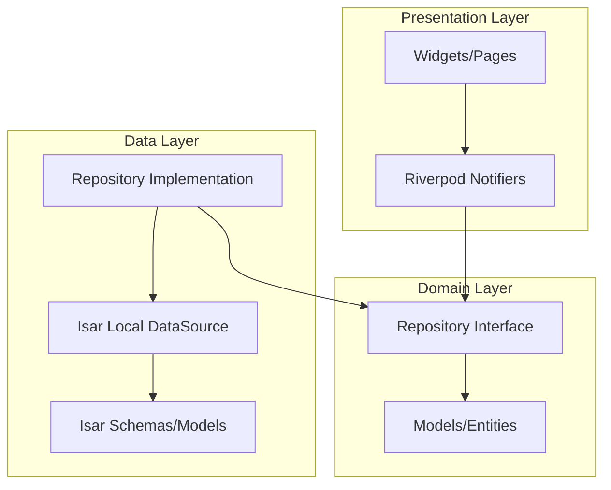

# UpahKu — Penggajian Harian Offline

<p align="center">
  
</p>

<p align="center">
  <strong>Aplikasi Android 100% Offline untuk Mengelola Penggajian Karyawan Harian</strong><br/>
  <em>Cepat · Praktis · Profesional · Tanpa Internet</em>
</p>

<p align="center">
  
  
  
  
  
  
</p>

---

## Daftar Isi

1. [Tentang Aplikasi](#tentang-aplikasi)
2. [Fitur Utama](#fitur-utama)
3. [Brand Identity](#brand-identity)
4. [Tech Stack](#tech-stack)
5. [Arsitektur Proyek](#arsitektur-proyek)
6. [Struktur Folder](#struktur-folder)
7. [Panduan Instalasi](#panduan-instalasi)
8. [Build APK & App Bundle](#build-apk--app-bundle)
9. [Panduan Penggunaan](#panduan-penggunaan)
10. [Sistem Desain](#sistem-desain)
11. [Alur Bisnis](#alur-bisnis)
12. [Rencana Pengembangan](#rencana-pengembangan)
13. [Dependensi](#dependensi)
14. [Lisensi](#lisensi)

---

## Tentang Aplikasi

**UpahKu** adalah aplikasi Android yang dirancang khusus untuk **mandor proyek, bengkel, workshop, gudang, kontraktor, UMKM, dan pabrik kecil** guna mengelola penggajian karyawan harian secara **100% offline**.

Aplikasi dibangun menggunakan **Flutter** dengan arsitektur bersih (**Clean Architecture**), **Riverpod** sebagai state management, dan **Isar Database** sebagai penyimpanan lokal berkinerja tinggi.

### Target Pengguna

Mandor Proyek · Bengkel · Pabrik Kecil · Gudang · Kontraktor · Workshop · UMKM · Admin Lapangan

### Karakter Aplikasi

- **Profesional** — Slip gaji PDF berlogo, siap cetak & share
- **Cepat** — Auto-save instan, tanpa loading
- **Praktis** — Input satu ketukan, tidak ribet
- **Modern** — Dark Mode, Material 3, animasi halus
- **Offline First** — Semua data lokal, tanpa internet
- **Terpercaya** — Database terenkripsi di perangkat

---

## Fitur Utama

### Inti Aplikasi

| Fitur | Deskripsi |
|-------|-----------|
| **Dashboard Statistik** | Total karyawan aktif, kehadiran hari ini, jam lembur, dan estimasi gaji |
| **Manajemen Karyawan** | CRUD data karyawan (Nama, Jabatan, Upah Harian, Tarif Lembur) |
| **Absensi Harian** | Checklist satu ketukan: Hadir / Izin / Sakit / Alfa — auto-save |
| **Pencatatan Lembur** | Counter jam lembur (± 0.5 jam) — auto-save |
| **Bonus & Potongan** | Input bonus, potongan operasional, dan kasbon |
| **Engine Penggajian** | Kalkulasi otomatis berdasarkan periode tanggal kustom |
| **Slip Gaji PDF** | Format A5 premium dengan logo UpahKu, siap cetak/share |
| **Riwayat Penggajian** | Arsip lengkap seluruh riwayat pembayaran |
| **Backup & Restore** | Ekspor/Impor database `.isar` untuk pengamanan data |

### Pengalaman Pengguna (UX)

| Fitur | Deskripsi |
|-------|-----------|
| **Dark Mode** | Switch tema Terang / Gelap / Sistem di halaman Pengaturan |
| **Auto-Save** | Absensi & lembur tersimpan otomatis tanpa tombol simpan |
| **Format Rupiah** | Pemisah ribuan otomatis saat input nominal (1.500.000) |
| **Welcome Onboarding** | 3 slide intro premium saat pertama kali membuka aplikasi |
| **Header Tunggal** | Tanpa duplikasi AppBar — desain bersih dan rapi |

---

## Brand Identity

### Logo

<p align="center">
  
  &nbsp;&nbsp;&nbsp;
  
</p>

### Palet Warna

| Warna | Hex | Kegunaan |
|-------|-----|----------|
| Navy Blue | `#0F1F3D` | Warna utama — logo, teks judul |
| Emerald Green | `#10B981` | Warna aksen — checkmark, tombol CTA |
| Off White | `#F5F7FA` | Background light mode |
| Medium Gray | `#6B7280` | Teks sekunder |

### Tipografi

- **Font Utama:** Outfit (Google Fonts) — Sans-Serif Modern, Geometris, Profesional

---

## Tech Stack

| Teknologi | Deskripsi |
|-----------|-----------|
| [Flutter 3.35+](https://flutter.dev) | Framework UI cross-platform |
| [Dart 3.9+](https://dart.dev) | Bahasa pemrograman |
| [Isar Database v3](https://isar.dev) | Database NoSQL ultra-cepat, offline |
| [Riverpod v2](https://riverpod.dev) | State management type-safe |
| [pdf](https://pub.dev/packages/pdf) + [printing](https://pub.dev/packages/printing) | Generator & printer PDF |
| [SharedPreferences](https://pub.dev/packages/shared_preferences) | Penyimpanan pengaturan lokal |
| [Google Fonts](https://pub.dev/packages/google_fonts) | Tipografi Outfit |

---

## Arsitektur Proyek

Aplikasi menerapkan **Clean Architecture** 4 layer:



| Layer | Tanggung Jawab |
|-------|---------------|
| **Core** | Tema, konstanta warna, utilitas (currency formatter, PDF generator, date formatter) |
| **Domain** | Entitas model bisnis & abstraksi kontrak repositori |
| **Data** | Implementasi repositori, Isar DataSource, dan model database `.g.dart` |
| **Presentation** | UI (Material 3), state notifier (Riverpod Providers), dan halaman |

---

## Struktur Folder

```text
lib/
├── core/
│   ├── constants/        # Konstanta warna brand UpahKu
│   ├── theme/            # Konfigurasi tema Light & Dark Mode (Outfit Font)
│   └── utils/            # Formatter mata uang, tanggal, dan PDF generator berlogo
├── data/
│   ├── datasources/
│   │   └── local/        # Layanan database Isar (IsarServiceImpl)
│   ├── models/           # Isar database models & generated schemas (.g.dart)
│   └── repositories/     # Implementasi konkret dari repositori domain
├── domain/
│   └── repositories/     # Abstraksi antarmuka repositori data
├── presentation/
│   ├── pages/
│   │   ├── welcome/      # Welcome Page onboarding (3 slide)
│   │   ├── dashboard/    # Dashboard statistik dengan logo UpahKu
│   │   ├── karyawan/     # Form & list karyawan
│   │   ├── absensi/      # Input absensi auto-save
│   │   ├── lembur/       # Input lembur counter auto-save
│   │   ├── bonus_potongan/ # Input bonus, potongan, kasbon
│   │   ├── penggajian/   # Kalkulasi & slip gaji PDF
│   │   └── settings/     # Pengaturan (tema, profil, backup/restore)
│   ├── providers/        # State Notifier & providers (Riverpod)
│   └── widgets/          # Komponen UI global reusable
├── assets/
│   └── images/           # Logo UpahKu (dark & light variant)
└── main.dart             # Entry point & inisialisasi aplikasi
```

---

## Panduan Instalasi

### Prasyarat

- Flutter SDK `3.10.0+`
- Java Development Kit (JDK 17)
- Android SDK Platform toolchain

### Langkah-Langkah

```bash
# 1. Clone repositori
git clone https://github.com/username/upahku.git
cd upahku

# 2. Install dependensi
flutter pub get

# 3. Generate skema Isar
flutter pub run build_runner build --delete-conflicting-outputs

# 4. Jalankan di emulator/perangkat
flutter run
```

---

## Build APK & App Bundle

### APK Release (untuk instalasi langsung di HP)
```bash
flutter build apk --release
```
Output: `build/app/outputs/flutter-apk/app-release.apk`

### App Bundle (untuk Google Play Store)
```bash
flutter build appbundle --release
```
Output: `build/app/outputs/bundle/release/app-release.aab`

### APK Debug (untuk uji coba)
```bash
flutter build apk --debug
```

---

## Panduan Penggunaan

### 1. Pengaturan Awal

- Buka **Pengaturan** (ikon gerigi di pojok kanan atas Dashboard)
- Input **Nama Usaha** dan **Alamat Usaha** — akan muncul di header Slip Gaji PDF
- Pilih **Mode Tema**: Terang / Gelap / Sistem

### 2. Tambah Karyawan

- Tab **Karyawan** → tombol **+ Karyawan**
- Isi: Nama, Jabatan, Upah Harian (Rp), Tarif Lembur per Jam
- Input nominal otomatis berformat pemisah ribuan (1.500.000)

### 3. Pencatatan Absensi Harian

- Menu **Input Harian** → tab **Absensi**
- Pilih tanggal → Ketuk status karyawan (H/I/S/A)
- Data **tersimpan otomatis** — tidak perlu klik simpan

### 4. Pencatatan Lembur

- Menu **Input Harian** → tab **Lembur**
- Gunakan tombol `[ - ]` `[ + ]` untuk mengatur durasi (kelipatan 0.5 jam)
- Data **tersimpan otomatis**

### 5. Bonus, Potongan & Kasbon

- Menu **Input Harian** → tab **Tambahan**
- Tambah transaksi: pilih tipe → isi nominal → pilih karyawan

### 6. Proses Penggajian

- Pilih menu **Penggajian** di navigasi bawah
- Tentukan **periode tanggal** → klik **Hitung Gaji**
- Simpan penggajian → Ketuk nama karyawan → Lihat **Slip Gaji PDF** berlogo UpahKu
- Cetak atau bagikan via WhatsApp

### 7. Backup & Restore

- **Pengaturan** → bagian **Ekspor & Impor Data**
- **Ekspor**: Simpan/kirim file database `.isar`
- **Impor**: Pulihkan data dari file backup

---

## Sistem Desain

| Aspek | Detail |
|-------|--------|
| **Design System** | Material 3 (Material You) |
| **Tipografi** | Outfit (Google Fonts) — geometris, modern |
| **Primary** | Navy Blue `#0F1F3D` |
| **Accent** | Emerald Green `#10B981` |
| **Error** | Crimson Red `#EF4444` |
| **Surfaces** | Adaptif Light/Dark berdasarkan preferensi tema |
| **Border Radius** | `16dp` untuk Card, `12dp` untuk Input/Button |
| **Elevation** | Rendah (flat) + border tipis — *clean design* |
| **Spacing** | Kelipatan 8dp (8, 12, 16, 24) |

---

## Alur Bisnis

```text
[ Data Master Karyawan ]
          │
          ▼
┌─────────────────────────────────────────────┐
│          Catatan Transaksi Harian           │
├───────────────┬─────────────┬───────────────┤
│  Absensi      │ Lembur      │ Bonus/Potongan│
│  (Auto-save)  │ (Auto-save) │   (Manual)    │
└───────────────┴─────────────┴───────────────┘
          │              │              │
          └──────────────┼──────────────┘
                         ▼
             [ Form Periode Penggajian ]
             (Pilih Tanggal Mulai & Selesai)
                         │
                         ▼
          ┌──────────────────────────────┐
          │   Engine Perhitungan Gaji    │
          │  Upah Kerja + Lembur +       │
          │  Bonus - Potongan - Kasbon   │
          └──────────────────────────────┘
                         │
                         ▼
             [ Slip Gaji PDF A5 ]
          (Berlogo UpahKu · Cetak/Share)
                         │
                         ▼
             [ Riwayat & Arsip ]
          (Tersimpan lokal permanen)
```

---

## Rencana Pengembangan

| Prioritas | Fitur | Deskripsi |
|:---------:|-------|-----------|
| Tinggi | Ekspor ke Excel | Rekap absensi & gaji bulanan ke `.xlsx` |
| Sedang | WhatsApp Broadcast | Kirim slip gaji langsung ke WA karyawan |
| Sedang | Cloud Backup | Sinkronisasi otomatis ke Google Drive |
| Rendah | Multi User | Hak akses staf lapangan vs pemilik usaha |

---

## Dependensi

| Package | Versi | Kegunaan |
|---------|-------|----------|
| `flutter_riverpod` | `^2.x` | State management type-safe |
| `isar` | `^3.x` | Database NoSQL lokal ultra-cepat |
| `isar_flutter_libs` | `^3.x` | Library native Isar untuk Android |
| `pdf` | `^3.x` | Generator PDF slip gaji |
| `printing` | `^5.x` | Preview & cetak PDF native |
| `shared_preferences` | `^2.x` | Penyimpanan pengaturan & tema |
| `file_picker` | `^8.x` | Dialog pemilihan file untuk restore |
| `share_plus` | `^10.x` | Share slip gaji via apps lain |
| `google_fonts` | `^6.x` | Font Outfit |
| `intl` | `^0.19.x` | Format tanggal & mata uang Rupiah |

---

## Lisensi

Proyek ini dirilis di bawah lisensi **MIT License**.
Anda bebas menggunakannya untuk tujuan komersil maupun non-komersil.

---

<p align="center">
  <strong>UpahKu</strong> — Penggajian Harian Offline<br/>
  <em>Dibuat dengan Flutter</em>
</p>
